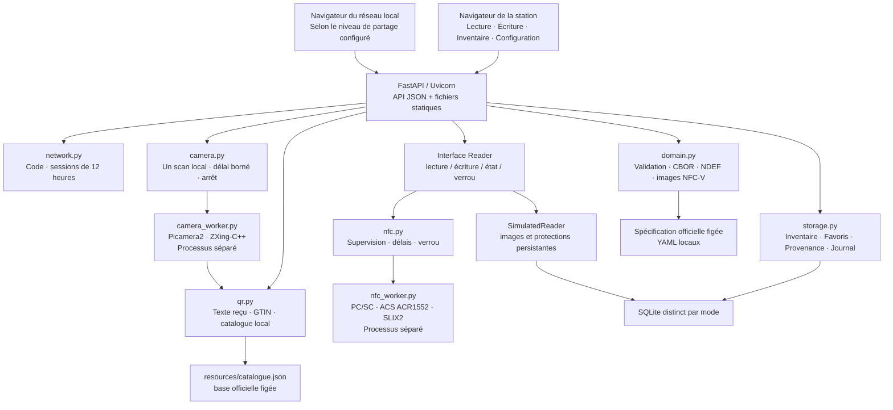

# Architecture d’OPT Station

L’application associe un serveur FastAPI, une base SQLite, une interface web et des processus séparés pour les accès matériels. Les profils pris en charge et leurs limites sont décrits dans le [guide de vérification](08-verification-prototype.md).

**Accès réseau de `v0.3.0` :** `network.py` conserve la clé du code dans le répertoire de données avec des permissions privées et gère les sessions navigateur de 12 heures. Lorsque le partage est ouvert, Configuration, inventaire et favoris restent accessibles sans code sur le LAN. Les routes NFC, caméra et simulateur exigent soit la boucle locale, soit une session autorisée après activation de `--lan`. Le code et son renouvellement restent réservés à la boucle locale. L’API continue à vérifier les hôtes, les origines et les requêtes JSON; Uvicorn n’interprète pas les en-têtes de proxy comme identité du client. Voir le [guide réseau](13-acces-reseau.md).

Architecture de `v0.4.0`, le 25 octobre 2026, avec caméra OV5647 et accès NFC réel ACS ACR1552U-M1 sur Raspberry Pi OS/Trixie arm64. Une fiche Prusament a été écrite et relue depuis l’interface sur un tag SLIX2. Le mode simulation reste disponible. Le Module 3, le tactile et la fiabilité optique à 20 cm restent à vérifier.

## Organisation

La page HTML référence les ressources statiques avec une empreinte SHA-256 de leur contenu dans l’URL. Le serveur envoie `Cache-Control: no-store` pour la page et les API, et `no-cache` pour les ressources statiques, y compris leurs réponses conditionnelles. Cela évite de mélanger un HTML récent avec un script ancien après installation. Le script du thème initialise ses propres contrôles indépendamment du script métier.

| Élément | Rôle actuel |
| --- | --- |
| `openprinttag_app/__main__.py`, `config.py` | Options de lancement, écoute, hôtes autorisés et répertoire de données. |
| `openprinttag_app/app.py` | Routes, séparation accès local/LAN, contrôle de concurrence, préparation et confirmation des écritures. |
| `openprinttag_app/network.py` | Code persistant, limitation des tentatives, autorisations temporaires des navigateurs. |
| `openprinttag_app/domain.py` | Interprétation des définitions officielles, validation des champs et codec des images de tag. |
| `openprinttag_app/readers.py` | Contrat du lecteur, révisions incluant les protections et simulateur persistant. |
| `openprinttag_app/nfc.py`, `nfc_worker.py` | Processus PC/SC supervisé, lecture du tag et des protections, sauvegarde et écriture par blocs vérifiée. |
| `openprinttag_app/storage.py` | Stock, favoris, identité des bobines, provenance locale et journal d’opérations SQLite. |
| `openprinttag_app/qr.py` | Classification du texte reçu et recherche GTIN sans requête réseau. |
| `openprinttag_app/camera.py`, `camera_worker.py` | Supervision d’un scan, aperçu temporaire, capture et décodage QR sur le Pi. |
| `openprinttag_app/static/` | Interface française HTML/CSS/JavaScript, sans framework, compilation ni CDN. |
| `scripts/build_catalogue.py` | Construction locale reproductible du catalogue à partir des références archivées. |

L’interface et l’API sont servies par le même processus et la même origine. Le lancement documenté est `python -m openprinttag_app`, depuis l’arborescence source complète. Le paquet Python embarque les fichiers statiques, mais pas encore les références ni le catalogue placés à la racine : une wheel isolée n’est pas une livraison autonome.

## Standard et limites du codec

Le domaine charge les YAML de la spécification avec `yaml.safe_load` et utilise `cbor2` pour les données CBOR. Les utilitaires Python téléchargés depuis les dépôts officiels ne sont pas importés ni exécutés par l’application.

Le codec prend en charge le profil **NFC-V avec Capability Container E1 de quatre octets**, un enregistrement NDEF de type `application/vnd.openprinttag`, les métadonnées de régions et les champs Main/Aux. Il ne constitue pas une implémentation universelle de tous les profils NFC ou de toutes les images possibles. Un profil non pris en charge est refusé explicitement.

Les créations du simulateur utilisent une image de 320 octets. Sur le SLIX2 physique identifié, l’image complète conserve les 320 octets mais le conteneur est limité à 312 octets : les blocs 78 et 79 sont préservés, dont le compteur matériel. Main et Aux sont calculés dans ce conteneur, avec un début d’Aux aligné sur quatre octets. Une création conserve les octets réservés du tag lu.

Les champs de l’éditeur proviennent du schéma officiel. L’API expose les énumérations connues sous leurs tokens officiels, les UUID en texte, les octets en hexadécimal et les couleurs en `#RRGGBB` ou `#RRGGBBAA`. Les modifications conservent les éléments non édités, dont les clés et valeurs d’énumération inconnues déjà présentes, les autres enregistrements et les limites des régions. L’identité de bobine ne peut pas être remplacée par une simple modification.

La quantité restante est calculée à partir de la masse initiale réelle si elle existe, sinon de la masse nominale, moins la masse consommée. L’absence de consommation produit un restant inconnu. Le recours à la masse nominale est signalé comme une estimation.

## Parcours de lecture et stock

Une lecture locale récupère l’image et les protections, décode les données, puis cherche l’identité dans SQLite. Une bobine inconnue n’entre en stock que par un ajout explicite. Une bobine connue voit son instantané et sa date de dernière lecture actualisés ; son état « retirée » est conservé jusqu’à son ajout explicite.

Les liaisons entre UID du tag et `instance_uuid` de bobine sont uniques. Une identité incohérente est refusée pour éviter de remplacer silencieusement une fiche. Le réemploi d’un tag pour une autre bobine reste une opération future à définir.

Le stock correspond à la dernière lecture locale, sans synchronisation directe avec l’imprimante. Après une consommation inscrite sur le tag par une imprimante compatible, une relecture est nécessaire. Les dates de dernière lecture sont celles enregistrées par la station, pas des événements transmis par l’imprimante.

Les retraits de stock et les modifications de favoris utilisent un numéro de version. Une écriture concurrente devenue obsolète est refusée avec un conflit ; l’utilisateur actualise les données avant de recommencer.

## Parcours d’écriture et résultat incertain

1. **Lire** le tag et conserver son UID ainsi qu’une révision SHA-256 de l’image et de ses protections.
2. **Préparer** une création sur tag vierge ou une modification. Le serveur relit le tag, contrôle UID/révision, valide les champs, les capacités et les protections Main/Aux, puis produit un aperçu avant/après.
3. **Confirmer** un jeton temporaire, valable cinq minutes et à usage unique. Le serveur contrôle à nouveau le tag ; un verrou de lecteur sérialise les opérations.
4. **Journaliser**, écrire, puis **relire**. Le résultat n’est confirmé que si l’UID et l’image relue correspondent exactement à l’image demandée.
5. **Enregistrer** la provenance locale et actualiser l’instantané d’inventaire si la bobine est déjà connue.

Les préparations sont conservées uniquement en mémoire : un redémarrage les invalide. Une écriture n’ajoute pas automatiquement une nouvelle bobine au stock. Le texte QR et la référence de favori appliqués sont des métadonnées locales de provenance, pas des extensions inventées du format NFC.

Le journal SQLite distingue `pending`, `tag_verified`, `complete` et `uncertain`. L’image NFC et la base ne peuvent pas participer à une transaction atomique commune. Si l’écriture ou sa relecture échoue, le résultat est signalé comme incertain. Si le tag est vérifié mais que la mise à jour SQLite échoue, l’erreur précise cette différence. Dans les deux cas, **aucune réécriture automatique** : relire le tag et réconcilier les données avant une nouvelle tentative. Un arrêt brutal peut également laisser une opération en attente d’examen. Le journal est accessible localement par `/api/operations` ; il n’a pas encore d’écran dédié.

## Persistance et modes

SQLite conserve les instantanés des bobines, leur appartenance au stock, les favoris, les sources appliquées et le journal. Le simulateur conserve également ses images et protections dans cette base. Les connexions utilisent le mode WAL ; les opérations de base sont transactionnelles, avec contrôle de version pour les modifications concurrentes.

| Mode | Base par défaut | Lecteur |
| --- | --- | --- |
| `simulation` | `var/simulation.sqlite3` | Simulateur ; aucune commande NFC physique. |
| `hardware` | `var/inventory.sqlite3` | Lecteur PC/SC réel, ACS ACR1552U-M1; écriture limitée au profil SLIX2 vérifié. |

Il n’y a pas de bascule automatique selon la présence d’un périphérique. Le répertoire se règle par `--data-dir` ou `OPENPRINTTAG_DATA_DIR`. Le stock d’essai ne devient pas le stock réel lors du changement de mode. Les sauvegardes doivent porter sur le répertoire de données complet, application arrêtée, y compris les éventuels fichiers SQLite compagnons.

## QR, catalogue et favoris

L’acquisition reçoit du texte collé, saisi par un scanner de type clavier ou capturé par la caméra activée avec `--camera`. La première caméra retenue est l’ancienne OV5647 à mise au point fixe; voir les [essais et limites](11-camera-qr.md). Le bouton caméra lance un processus séparé utilisant Picamera2 et ZXing-C++. Le serveur continue à répondre pendant l’ouverture et la recherche. Un seul essai peut être actif; l’annulation et l’arrêt de l’application libèrent le processus. Un blocage natif est interrompu après un délai borné, y compris si aucune image n’arrive.

Les routes `/api/camera/scans`, leur état, l’aperçu JPEG et l’annulation exigent une connexion locale, avec les mêmes contrôles JSON et d’origine que les autres commandes. Le scan cherche pendant 45 secondes après ouverture. Le texte et l’aperçu restent dans un répertoire temporaire privé, nettoyé au prochain essai, trois minutes après la fin ou à l’arrêt du serveur. Ils ne sont pas ajoutés à l’inventaire. L’utilisateur choisit **Utiliser ce code** pour alimenter l’inspecteur existant; la provenance est enregistrée seulement au moment d’une écriture vérifiée.

L’inspecteur contrôle les GTIN de 8, 12, 13 ou 14 chiffres et leur clé, puis consulte le catalogue local. Les jointures fabricant/matériau/conditionnement viennent des références officielles, avec conversion explicite des unités utiles. Un résultat ambigu demande un choix ; un GTIN absent n’apporte pas de propriétés matériau supposées.

Une URL n’est pas visitée et un texte inconnu n’est pas traité comme une équivalence NFC. Aucun téléchargement de page fabricant n’est effectué. La donnée brute reste disponible comme provenance locale lorsqu’elle est appliquée à une écriture vérifiée.

Les favoris ne contiennent que des données Main réutilisables. Le domaine exclut notamment identité individuelle, masse réelle de la bobine, dates individuelles et protection ; la consommation Aux n’y figure pas. Modifier un favori ne change aucun tag existant.

### Références figées utilisées

| Référence | Commit |
| --- | --- |
| Spécification et champs | `060e420892d66c062c8af440c97701aab96bac79` |
| Schémas d’architecture | `954d050b1a83a8cee03ea8ab8d342d6741c61281` |
| Base officielle de matériaux et conditionnements | `2451ae7adc115cfc40cf1892bddbb0b4a2f1b1a3` |

`resources/catalogue.json` conserve ces versions, l’empreinte SHA-256 de son archive source, les chemins de fiches d’origine et le texte de licence MIT de la base. `scripts/build_catalogue.py` vérifie l’empreinte attendue de l’archive avant génération. Il n’y a pas de mise à jour automatique du catalogue en exploitation. Le détail des archives, empreintes et licences est dans [les sources et la provenance](04-sources-et-provenance.md).

## Accès local et réseau

L’écoute par défaut est `127.0.0.1:8765`. `--lan` active l’écoute IPv4 sur `0.0.0.0` et les niveaux de partage persistants désactivé/inventaire/complet sans code. Les `--allowed-host` correspondent aux adresses ou noms utilisés. Les contrôles d’hôte, de requêtes JSON et d’origine du navigateur restent appliqués.

Les fonctions matérielles nécessitent un client local ou le partage complet. Le partage inventaire autorise les fonctions de stock et de bibliothèque sans les commandes du matériel. En HTTPS, le serveur est lié à la boucle locale et interprète les en-têtes validés de la passerelle Caddy configurée; Caddy remplace ceux du client. Sans configuration HTTPS, ces en-têtes ne donnent aucun droit supplémentaire. Voir le [guide réseau](13-acces-reseau.md) et le [guide HTTPS](31-https-local.md).

## Multilingue

Les textes français et anglais sont séparés de la logique d’interface. Le choix est mémorisé par navigateur. Les champs, valeurs et unités OpenPrintTag, données API/CBOR, identifiants et QR bruts conservent leur représentation. Les contenus saisis ne sont pas traduits automatiquement; voir le [guide des langues](22-langues-interface.md).

## Adaptateur NFC matériel

L’adaptateur matériel utilise PC/SC avec un lecteur ACS ACR1552U-M1. L’adaptateur lit UID, géométrie, mémoire, verrous permanents et conditions de protection par page SLIX2. Une protection inconnue interdit l’écriture. Le processus conserve la transaction PC/SC et adresse chaque commande RF par UID; il recontrôle la révision complète avant toute écriture, puis chaque bloc et l’image entière. Les sauvegardes `.bin`/`.json` privées sont enregistrées et synchronisées avant la première commande d’écriture. Une mise à jour n’écrit que les blocs modifiés et ne réécrit pas les en-têtes ni les régions inchangées.

Les appels natifs sont exécutés dans un processus séparé : état limité à 3 secondes, lecture à 8 et écriture à 18. Un blocage est interrompu sans répétition automatique. Un refus prouvé avant toute écriture est distinct d’un résultat incertain. Le redémarrage de la station marque aussi comme incertaines les opérations restées `pending`. Aucune commande de mot de passe ou de verrouillage n’est implémentée. Une seule instance serveur utilise la base et le lecteur.

Les protections et interruptions sont testées en simulation; les profils matériels nécessitent aussi des essais physiques. La fiabilité optique à courte distance, les autres profils NFC et l’écran tactile restent à qualifier. Les sauvegardes, l’export et la reprise d’association d’un RFID sont désormais disponibles; leurs limites et les travaux restants figurent dans la [feuille de route](14-feuille-de-route.md).

Les licences des références tierces et des dépendances sont conservées; voir [les notices](../THIRD_PARTY_NOTICES.md).

Voir le [mode d’emploi](06-mode-emploi.md) pour les commandes et le [cahier des charges](05-cahier-des-charges.md) pour les besoins fonctionnels.
